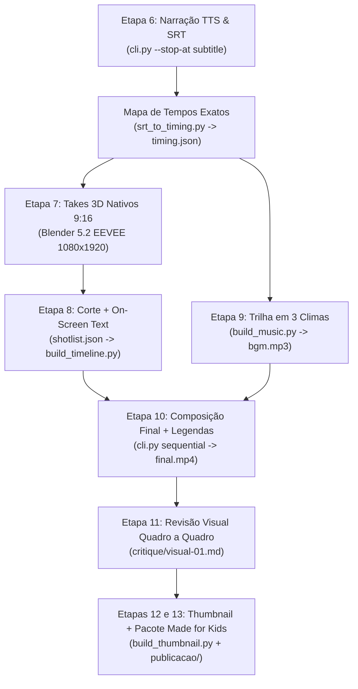

# Planejamento de Pós-Produção — "O que é a nuvem?" (`infortux`)

Este documento detalha o plano técnico das **Etapas 6 a 13** do pipeline de vídeo (`.agents/skills/video/SKILL.md`), transformando o roteiro e os ativos 3D aprovados no arquivo final `output/final.mp4` (`1080x1920`, `30 fps`, `~60s`).

---

## 1. Visão Geral do Fluxo de Pós-Produção



---

## 2. Layout de Tela e Zonas Seguras (`1080x1920` — YouTube Shorts)

Para evitar que a interface do YouTube Shorts ou as legendas escondam os objetos 3D, todos os takes no Blender e textos seguem este gabarito vertical:

| Faixa Vertical (`Y`) | O que ocupa a faixa | Regra de Pós-Produção |
|---|---|---|
| **`0 – 160 px`** | Margem superior da UI do Shorts | Área livre (apenas o fundo geométrico Ubuntu Suru). |
| **`160 – 420 px`** | **On-Screen Text (`texto_na_tela`)** | Fonte `BeVietnamPro-Bold.ttf` (`88pt`), cor `#F9BD3C`, caixa `box_color: #1D0A30@0.72`, máx. 2 linhas / 12 chars por linha. |
| **`420 – 1380 px`** | **Palco 3D Principal (Centro Óptico)** | Onde ficam o Pinguim Infortux, a Nuvem + Servidor, o Chip CPU, o Pacote de Dados e o Terminal `>_`. |
| **`1380 – 1660 px`** | **Legenda Queimada (`custom_position: 80%`)** | Fonte `BeVietnamPro-Bold.ttf` (`62pt`), branco `#FFFFFF`, contorno `#1D0A30` (`4px`), máx. 2 linhas simultâneas. |
| **`1660 – 1920 px`** | Margem inferior da UI do Shorts | Área protegida contra botões e barra de progresso do app. |

---

## 3. Plano de Takes 3D Dedicados em `9:16` (Blender 5.2)

Em vez de apenas cortar os vídeos quadrados de prévia, renderizaremos **6 takes verticais nativos (`1080x1920`, `30 fps`)** com câmera e animação ajustadas para cada momento da explicação:

| ID do Take | Arquivo em `raw/` | Cena / Enquadramento no Blender | Animação 3D | Usado nas Cenas |
|---|---|---|---|---|
| **Take A** | `raw/take_pinguim_curioso.mp4` | Plano médio vertical do `Infortux_Pinguim` centralizado em `Y=900px` | Inclinação curiosa da cabeça (`±6°`), piscada dupla e pulso nos fones laranjas | `01`, `11`, `12` |
| **Take B** | `raw/take_nuvem_servidor_geral.mp4` | Plano aberto vertical do `Infortux_CloudServer` (nuvem no topo, cabos no meio, rack na base) | Rotação suave (`-15°` a `+15°`) + pacotinhos de dados subindo/descendo nos feixes | `02`, `05`, `08` |
| **Take C** | `raw/take_servidor_blades_close.mp4` | Close-up nas 3 lâminas (*blades*) do Rack de Servidores Linux | Câmera fazendo *dolly-in* lento nas baias laranjas e LEDs amarelos de atividade | `06`, `10` |
| **Take D** | `raw/take_cpu_memoria.mp4` | Plano médio em ângulo isométrico do `Infortux_CPU_Chip` | Giro contínuo mostrando os pinos e o núcleo dourado `#F9BD3C` | `03` |
| **Take E** | `raw/take_pacote_dados.mp4` | `Infortux_DataPacket` em perspectiva dinâmica sobre o fundo Ubuntu Suru | Flutuação vertical + giro completo em 3 eixos | `04`, `07`, `13` |
| **Take F** | `raw/take_terminal_linux.mp4` | Monitor `Infortux_Terminal` com prompt `>_` apontando para a direita | Oscilação suave de vitrine dando destaque ao brilho do cursor `>_` | `09` |

---

## 4. Decupagem Completa da Timeline (13 Cortes Sincronizados)

Assim que a Etapa 6 gerar o `timing.json` real da voz `pt-BR-AntonioNeural-Male`, o `shotlist.json` será preenchido com a duração exata de cada frase:

| Cena | Frase narrada (`script.txt`) | Fonte (`raw/`) | Modo (`kind`) | `text` (`text_pos: top`) | Efeito / Intenção de Edição |
|---|---|---|---|---|---|
| **01** | *Quando você salva uma foto na nuvem, ela sobe para o céu?* | `take_pinguim_curioso.mp4` | `fill` | `SOBE PRO\nCÉU?` | Gancho visual imediato com o mascote olhando nos olhos e pergunta no topo. |
| **02** | *Não mesmo! Na tecnologia, a nuvem fica bem firme aqui no chão.* | `take_nuvem_servidor_geral.mp4` | `fill` | `FICA NO\nCHÃO!` | Corte revelando que a nuvem está ligada por cabos a um rack de servidores. |
| **03** | *Pense na memória do celular como a sua mochila da escola.* | `take_cpu_memoria.mp4` | `fill` | `SUA\nMOCHILA` | Chip de memória 3D ilustra o espaço interno limitado do aparelho. |
| **04** | *Se colocar cadernos demais, a mochila fica cheia e bem pesada.* | `take_pacote_dados.mp4` | `fill` | `MEMÓRIA\nCHEIA` | Cubo de dados robusto ocupa o quadro para dar sensação de volume. |
| **05** | *A nuvem funciona como um armário gigante guardado em outro prédio.* | `take_nuvem_servidor_geral.mp4` | `fill` | `ARMÁRIO\nGIGANTE` | Retorno ao sistema Nuvem + Servidor mostrando o armazenamento remoto. |
| **06** | *Esses prédios são os data centers, cheios de computadores chamados servidores.* | `take_servidor_blades_close.mp4` | `fill` | `DATA\nCENTER` | Close-up nas gavetas (*blades*) roxas e laranjas do servidor com LEDs acesos. |
| **07** | *Eles enviam dados pelo mundo usando cabos de luz sob o mar!* | `take_pacote_dados.mp4` | `fill` | `CABOS NO\nMAR` | Pacote de dados em movimento rápido simbolizando o tráfego óptico submarino. |
| **08** | *Quando você assiste a um vídeo, o servidor manda cada pedacinho.* | `take_nuvem_servidor_geral.mp4` | `fill` | `VEM EM\nPACOTES` | Destaque para os cubinhos amarelos e laranjas viajando nos feixes entre nuvem e rack. |
| **09** | *E sabe quem comanda quase todos esses servidores da nuvem? O Linux!* | `take_terminal_linux.mp4` | `fill` | `SERVIDOR\nLINUX!` | Entrada do Terminal `>_` conectando a infraestrutura da nuvem ao Linux. |
| **10** | *Mas atenção: a nuvem é apenas o computador de outra empresa.* | `take_servidor_blades_close.mp4` | `fill` | `OUTRO\nCOMPUTADOR` | Foco sério no hardware do servidor reforçando o alerta do CERT.br. |
| **11** | *Por isso, sempre peça ajuda a um adulto antes de salvar arquivos.* | `take_pinguim_curioso.mp4` | `fill` | `PEÇA A UM\nADULTO` | Mascote volta à tela em tom acolhedor de orientação familiar. |
| **12** | *Hora do desafio desplugado com um adulto aí na sua casa!* | `take_pinguim_curioso.mp4` | `fill` | `DESAFIO\nEM CASA!` | Mudança de energia na trilha para lançar a atividade prática. |
| **13** | *Escolham três fotos especiais para guardar fora da internet, num pendrive.* | `take_pacote_dados.mp4` | `fill` | `GUARDAR\nEM CASA` | Fechamento com o pacote de dados seguro e loop visual limpo com a Cena 01. |

---

## 5. Engenharia de Áudio e Sound Design

1. **Voz Principal (`TTS`)**:
   - Voz: `pt-BR-AntonioNeural-Male` (`--voice-rate 1.05`).
   - Processamento: normalização limpa no pipeline do MoneyPrinterOmni, sem *clipping*, mantendo dicção clara para o público de 7 a 12 anos.
2. **Trilha Musical em 3 Atos (`build_music.py` → `bgm.mp3`)**:
   - **0.0s – 18.0s (`curious` / `mystery` leve)**: pulso suave de abertura para a pergunta do céu e a analogia da mochila.
   - **18.0s – 42.0s (`tech` / `driving` suave)**: andamento rítmico acompanhando os *data centers*, cabos submarinos e o Linux.
   - **42.0s – 60.0s (`warm` / `uplifting`)**: fechamento acolhedor para a dica de privacidade com um adulto e o desafio do pendrive.
   - **Mixagem**: `--bgm-volume 0.12` (cerca de `-20 dB` abaixo da narração) com *crossfade* de `1.0s` nas transições de clima.

---

## 6. Comandos Exatos de Execução das Etapas 6 a 13

### Passo 6.1 — Gerar Narração + Legenda SRT e extrair `timing.json`
```sh
nix develop --command .venv/bin/python cli.py \
  --video-script "$(cat resource/projects/o-que-e-a-nuvem/script.txt)" \
  --video-language pt-BR \
  --voice-name pt-BR-AntonioNeural-Male \
  --voice-rate 1.05 \
  --stop-at subtitle

python3 .agents/skills/video/scripts/srt_to_timing.py \
  <caminho_do_subtitle.srt> \
  resource/projects/o-que-e-a-nuvem/timing.json
```

### Passo 7.1 — Renderizar os 6 Takes 3D Verticais (`1080x1920`) no Blender
```sh
/usr/bin/blender -b --factory-startup --python-exit-code 1 \
  -P scripts/render_nuvem_takes_9x16.py
```

### Passo 8.1 — Gerar os 13 Clipes da Timeline (`timeline/01.mp4` .. `13.mp4`) + Grade de Prévia
```sh
python3 .agents/skills/video/scripts/build_timeline.py \
  resource/projects/o-que-e-a-nuvem --aspect 9:16 --preview
```

### Passo 9.1 — Gerar a Trilha Musical (`bgm.mp3`)
```sh
python3 .agents/skills/video/scripts/build_music.py \
  resource/projects/o-que-e-a-nuvem
```

### Passo 10.1 — Render Final (`final.mp4`) com Legendas Queimadas e Trilha
```sh
nix develop --command .venv/bin/python cli.py \
  --video-script "$(cat resource/projects/o-que-e-a-nuvem/script.txt)" \
  --video-language pt-BR \
  --voice-name pt-BR-AntonioNeural-Male \
  --voice-rate 1.05 \
  --video-aspect 9:16 \
  --video-source local \
  --video-materials "$(ls resource/projects/o-que-e-a-nuvem/timeline/*.mp4 | paste -sd,)" \
  --video-concat-mode sequential \
  --video-transition-mode none \
  --video-clip-duration 6 \
  --bgm-type custom \
  --bgm-file resource/projects/o-que-e-a-nuvem/bgm.mp3 \
  --bgm-volume 0.12 \
  --font-name BeVietnamPro-Bold.ttf \
  --font-size 62 \
  --text-fore-color "#FFFFFF" \
  --stroke-color "#1D0A30" \
  --stroke-width 4 \
  --subtitle-position custom \
  --custom-position 80.0
```

---

## 7. Checklist de Qualidade (QC) antes da Entrega Final

- [ ] **Sincronia Frase a Frase**: Soma das durações de `timeline/01.mp4`..`13.mp4` igual à duração de `audio.mp3` (tolerância `≤ 0.15s`).
- [ ] **Inspeção Visual (`raw/timeline_preview.png` + `final.mp4`)**:
  - [ ] Nenhum texto na tela (`#F9BD3C`) cortado nas bordas laterais.
  - [ ] Legenda inferior (`80%`) não cobre os olhos/bico do Pinguim nem os LEDs principais do servidor.
  - [ ] Zero quadros pretos ou congelados nas transições.
- [ ] **Conformidade *Made for Kids***:
  - [ ] Sem CTAs proibidos no áudio, texto na tela ou descrição.
  - [ ] Fontes primárias (CERT.br/NIC.br, NIST, TeleGeography, Linux Foundation) creditadas em `publicacao/descricao.md`.
